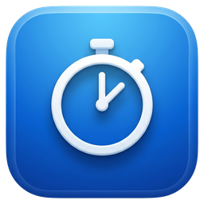

<h1> Time Tracker</h1>

[](https://github.com/RudiFreeman/TimeTracker/releases/latest)
[](https://github.com/RudiFreeman/TimeTracker/releases)


[](LICENSE)

Трекер рабочего времени для Windows (портативный `.exe`, без установки) и Mac (Apple Silicon). Таймер по задачам и подзадачам, журнал по дням с таймлайном, сводка с экспортом в Excel, учёт токенов AI-сервисов и защита от «забытого таймера». Все данные — в одном файле `timetracker.db`, его можно перенести между Windows и Mac.

---

## 🎯 Цель продукта

Честно и без лишних усилий знать, сколько времени ушло на каждую задачу: запустил таймер одной кнопкой, переключился на другую задачу — первая сама встала на паузу. В конце дня, недели или проекта — готовая сводка по часам, а не попытки вспомнить.

## 👤 Целевая аудитория

Монтажёры, продюсеры контента и другие специалисты, которые ведут несколько задач параллельно и отчитываются по времени. Небольшие команды: каждый работает со своей копией программы.

## 🚀 Текущая версия

Номер последней версии — на значке **version** выше, файл — на странице [Releases](https://github.com/RudiFreeman/TimeTracker/releases/latest). Что изменилось в каждой версии — в [CHANGELOG.md](CHANGELOG.md) и в самой программе: «О программе» → «Что нового».

---

## ⬇️ Установка

**Windows**

1. Скачайте `TimeTracker-….zip` со страницы [последнего релиза](https://github.com/RudiFreeman/TimeTracker/releases/latest).
2. Распакуйте в любую папку с правом записи (например `C:\TimeTracker`), **не** в Program Files — рядом с программой создаётся база `timetracker.db`.
3. Запустите `TimeTracker.exe`. Если Windows покажет «Система Windows защитила ваш компьютер» → «Подробнее» → «Выполнить в любом случае» (у программы нет цифровой подписи).

**Mac** (M1 и новее)

1. Скачайте `TimeTracker-…-mac.dmg` с той же страницы, откройте и перетащите TimeTracker в «Программы».
2. В первый раз macOS не откроет программу (нет платной подписи Apple): «Системные настройки» → «Конфиденциальность и безопасность» → «Всё равно открыть». Данные — в `~/Library/Application Support/TimeTracker` («Настройки» → «Открыть папку»).

**Обновление** — программа сама раз в день проверяет новую версию и обновляется одной кнопкой, данные сохраняются. Вручную: «О программе» → «Проверить обновления».

## ✨ Возможности

| | |
|---|---|
| ⏱ **Таймер** | Выбрать задачу и подзадачу → **Начать**. Кнопка подсказывает, что произойдёт: новая сессия, продолжение паузы или переключение |
| 🔀 **Переключение** | Запуск другой задачи ставит текущую на паузу. Список «в работе» сгруппирован по задачам, двойной клик — продолжить |
| 🪟 **Мини-окно** | Свернуть таймер → маленькая плашка поверх всех окон; значок в трее с текущим временем |
| 📅 **Журнал** | Дни с полосой-таймлайном (когда в сутках шла работа), правка времени и «＋ Время вручную», если забыли включить таймер |
| 📊 **Сводка** | Задача → подзадача → сессии, фильтр по периоду и поиск, экспорт CSV для Excel, отметка «сдана» |
| 🧮 **Токены** | Калькулятор расхода токенов AI-сервисов (ElevenLabs и т.п.) по задачам и моделям |
| 💾 **Резервные копии** | Копия базы раз в день, хранятся последние 14 |
| 🔄 **Автообновление** | Новая версия с GitHub Releases ставится одной кнопкой |

## 🛡 Защита от «забытого таймера»

- В конце рабочего дня (по умолчанию 18:00, настраивается) таймер сам встаёт на паузу. Запуск позже — только с подтверждением, тогда пауза в 23:59.
- Сон или блокировка ПК дольше 5 минут — пауза на моменте ухода.
- Аварийное выключение — при следующем запуске интервал закрывается по последней отметке (потеря не больше 15 секунд).
- Закрытие окна таймера ставит паузу. Одновременно работает только одна копия программы из одной папки.

## 🔒 Приватность

Программа ничего не собирает и никуда не отправляет: все данные — в файле `timetracker.db` рядом с программой (и его копии в `backups/`). В интернет она обращается только к GitHub, чтобы раз в день проверить, нет ли новой версии.

## 🧩 Как устроены данные

- **Задача** — продукт или проект (в коде и базе — `product`). **Подзадача** — вид работы: монтаж, съёмка, черновая сборка…
- **Сессия** — один заход работы над парой задача + подзадача, состоит из интервалов «старт → пауза».
- **Пауза** сохраняет сессию, **Завершить** закрывает её. Новый старт после завершения — новая сессия; в списке и отчётах время по подзадаче суммируется.

## 🛠 Сборка из исходников

```bat
pip install -r requirements.txt
python main.py
```

- Сборка `.exe`: `build.bat` → `dist\TimeTracker.exe` и архив релиза в `release\`. Mac: `sh build_mac.sh` → `.dmg` в `release/`.
- Обе версии собирает GitHub Actions при каждом push; тег `vX.Y.Z` — черновик релиза с `.zip` и `.dmg`.
- Тесты: `pip install -r requirements-dev.txt`, затем `python -m pytest`.

## 📄 Лицензия

[MIT](LICENSE) — программу можно бесплатно использовать, менять и распространять с указанием автора.
В сборку входят Qt / PySide6 (LGPL v3), Python (PSF License) и SQLite (public domain) — подробнее в [THIRD_PARTY_NOTICES.md](THIRD_PARTY_NOTICES.md).

Автор — Алексей Рудович.
